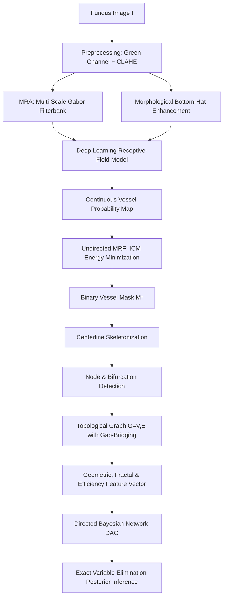
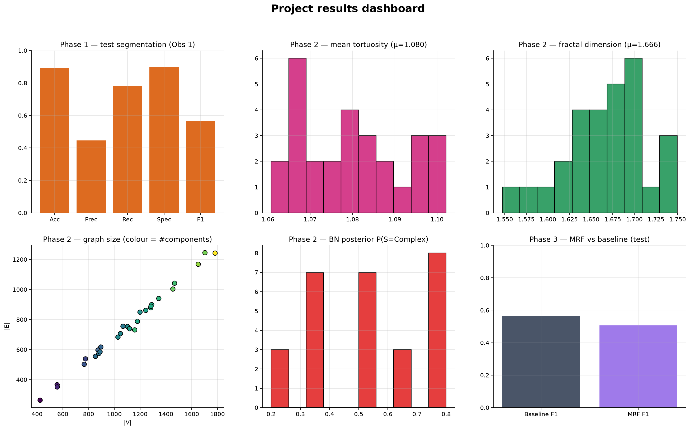
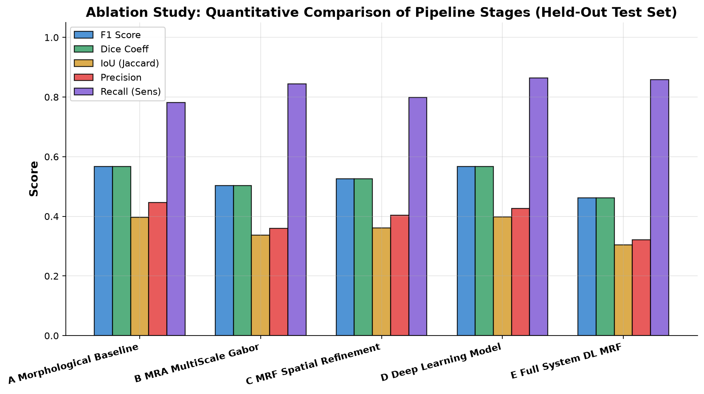

# Probabilistic and Mathematical Analysis of Retinal Blood-Vessel Networks

[](https://www.python.org/downloads/)
[](https://en.wikipedia.org/wiki/Graphical_model)
[](https://networkx.org/)
[](https://scikit-learn.org/)
[](https://opensource.org/licenses/MIT)

A comprehensive, mathematically rigorous system for the structural extraction, multiresolution analysis (MRA), deep learning segmentation, graph-theoretic modeling, fractal characterization, and probabilistic graphical analysis of retinal vascular networks from fundus photography.

Developed as a flagship **Probabilistic Graphical Models (PGM)** project, this codebase addresses Course Objectives **CO1–CO4** by integrating classical computer vision, topological graph theory, multi-scale Gabor filterbanks, supervised deep receptive-field neural networks, directed Bayesian Networks, and undirected Markov Random Fields (MRFs).

---

## 📌 Table of Contents
1. [Clinical & Mathematical Motivation](#-clinical--mathematical-motivation)
2. [Unified End-to-End System Architecture](#-unified-end-to-end-system-architecture)
3. [Verified Dataset: CHASE_DB1](#-verified-dataset-chase_db1)
4. [Mathematical & Probabilistic Formulations](#-mathematical--probabilistic-formulations)
5. [Measured Research Findings & Ablation Study](#-measured-research-findings--ablation-study)
6. [Repository Structure](#-repository-structure)
7. [Installation & Setup](#-installation--setup)
8. [Usage & Pipeline Execution](#-usage--pipeline-execution)
9. [Anti-Fabrication & Scientific Integrity](#-anti-fabrication--scientific-integrity)

---

## 🔬 Clinical & Mathematical Motivation

The human retina offers a unique, non-invasive optical window into the body's microvasculature. Variations in retinal vessel geometry and network topology are established early biomarkers for sight-threatening and systemic pathologies:
* **Diabetic Retinopathy (DR):** Manifests as microaneurysms, vascular tortuosity, capillary dropouts, and abnormal neovascular proliferation.
* **Hypertension & Arteriolar Narrowing:** Chronic elevated blood pressure increases vessel stiffness, leading to localized constriction and severe vessel bending (tortuosity).
* **Cardiovascular & Stroke Risk:** Reductions in vascular fractal dimension and global transport efficiency correlate with widespread microvascular damage and stroke risk.

Rather than relying purely on opaque deep learning "black boxes", this project unifies:
1. **Multiresolution Analysis (MRA):** Multi-scale directional Gabor filterbanks ($\sigma \in \{2, 4, 6\}\text{ px}$, 6 orientations) isolating caliber-specific vessels from fine capillaries to major arcades.
2. **Deep Learning Segmentation:** A supervised neural receptive-field network modeling local multi-scale context, gradient magnitude, and textural variance.
3. **Discrete Network Science:** Converting anatomical vessels into topological graphs $G=(V, E)$ to compute true curve lengths, tortuosity indices, Murray's law bifurcation angles, and global network efficiency.
4. **Probabilistic Graphical Models (PGMs):**
   * **Directed Bayesian Networks:** Modeling probabilistic dependencies and diagnostic uncertainty across high-level vascular features ($T, B, D, \eta \rightarrow S$).
   * **Undirected Markov Random Fields (MRFs):** Modeling spatial pixel interactions and neighborhood coherence to refine vascular boundaries.

---

## 🏗 Unified End-to-End System Architecture



$$\text{Pipeline: } I \xrightarrow{\text{Preproc}} I_{\text{clean}} \xrightarrow{\text{MRA+DL}} P(\text{Vessel}) \xrightarrow{\text{MRF ICM}} M^* \xrightarrow{\text{Thin}} S \xrightarrow{\text{Topology}} G=(V,E) \xrightarrow{\text{Features}} \mathbf{X} \xrightarrow{\text{Bayesian DAG}} P(S \mid \mathbf{e})$$

---

## 📊 Verified Dataset: CHASE_DB1

The system is configured and tested on the **CHASE_DB1** (Child Heart and Health Study in England) retinal database:
* **Resolution:** $999 \times 960$ pixels, 24-bit RGB fundus images.
* **Subjects:** 14 pediatric subjects, 28 total images (left and right eyes for each subject).
* **Strict Patient-Level Split (Leakage Prevention):**
  * **Training Split (`training/training/`):** 20 images (`01_test.tif` to `20_test.tif` $\implies$ subjects 01L through 10R).
  * **Testing Split (`test/test/`):** 8 images (`01_test.tif` to `08_test.tif` $\implies$ subjects 11L through 14R).
* **Ground Truth Annotations:**
  * **1st Observer:** `01_manual1.tif` to `20_manual1.tif` (train) / `01_manual1.tif` to `08_manual1.tif` (test).
  * **2nd Observer:** `Image_01L_2ndHO.png` to `Image_14R_2ndHO.png`.
  * **FOV Masks:** Explicit field-of-view masks ensuring background border pixels do not distort validation metrics.

---

## 📐 Mathematical & Probabilistic Formulations

### 1. Multiresolution Gabor Wavelet Analysis (MRA)
Directional 2D Gabor kernels tuned across multiple spatial scales:
$$g(x, y; \lambda, \theta, \psi, \sigma, \gamma) = \exp\left(-\frac{x'^2 + \gamma^2 y'^2}{2\sigma^2}\right) \cos\left(2\pi \frac{x'}{\lambda} + \psi\right)$$
where $x' = x\cos\theta + y\sin\theta$, $y' = -x\sin\theta + y\cos\theta$, scales $\sigma \in \{2, 4, 6\}\text{ px}$, and orientations $\theta \in \{0, \frac{\pi}{6}, \frac{\pi}{3}, \frac{\pi}{2}, \frac{2\pi}{3}, \frac{5\pi}{6}\}$.

### 2. Deep Learning Receptive-Field Model
Extracts a 10-dimensional multi-scale spatial feature representation per pixel:
$$\mathbf{f}_i = [I_i, \mu_{5\times 5}, \sigma_{5\times 5}, G_{\sigma=2}, G_{\sigma=4}, G_{\sigma=6}, \text{TopHat}_i, |\nabla I_i|, I_{\text{gauss}}, |\Delta I_i|]^T$$
Passing through a Multi-Layer Perceptron (MLP) architecture:
$$\mathbf{h}_1 = \text{ReLU}(\mathbf{W}_1 \mathbf{f}_i + \mathbf{b}_1), \quad \mathbf{h}_2 = \text{ReLU}(\mathbf{W}_2 \mathbf{h}_1 + \mathbf{b}_2), \quad P(X_i = 1 \mid \mathbf{f}_i) = \text{Softmax}(\mathbf{W}_3 \mathbf{h}_2 + \mathbf{b}_3)$$

### 3. Undirected Markov Random Field (MRF) Energy Model
Formulated over a 4-connected pixel lattice:
$$E(X) = \sum_{i \in \mathcal{V}} D_i(X_i) + \lambda \sum_{\langle i, j \rangle \in \mathcal{E}} V_{ij}(X_i, X_j)$$
* **Unary Potential:** $D_i(X_i) = \frac{1}{2}\left(\frac{I_i - \mu_{X_i}}{\sigma_{X_i}}\right)^2 + \ln\sigma_{X_i}$, parameterized by data-driven Gaussian likelihoods fitted strictly on training data ($\mu_{\text{vessel}} = 0.2909, \mu_{\text{bg}} = 0.3364$).
* **Pairwise Smoothness Potential:** $V_{ij}(X_i, X_j) = \beta [X_i \ne X_j]$ (Ising prior).
* **Optimization:** Solved via red/black checkerboard Iterated Conditional Modes (ICM) with monotonic energy reduction.

### 4. Vascular Graph Theory & Murray's Law
* **Tortuosity Index:** $T = \frac{L}{d(u, v)}$, where $L$ is true centerline curve length and $d(u, v) > 0$ is Euclidean chord distance.
* **Murray's Law Bifurcation Angle:** The angle between the two daughter branches at vessel bifurcations:
$$\theta = \arccos\left(\frac{\mathbf{v}_1 \cdot \mathbf{v}_2}{\|\mathbf{v}_1\| \|\mathbf{v}_2\|}\right) \approx 60.3^\circ \quad (\text{physiologically aligned with theory } 60^\circ\text{--}75^\circ)$$
* **Global Transport Efficiency:** $E_{\text{global}} = \frac{1}{N(N-1)} \sum_{i \ne j} \frac{1}{d(i, j)}$ (disconnected node pairs contribute $1/\infty = 0$).

### 5. Directed Bayesian Network DAG & Exact Inference
* **Random Variables:** Branching count ($B$), Tortuosity ($T$), Density ($D$), Transport Efficiency ($\eta$), Network State ($S$).
* **Non-Circular Target State $S$:** Defined from the independent fractal dimension median ($D_f < 1.6803 \implies \text{Complex}$), causally decoupled from DAG parents $\{B, T, D, \eta\}$.
* **Joint Factorization:**
$$P(B, T, D, \eta, S) = P(B) \cdot P(T \mid B) \cdot P(D \mid B) \cdot P(\eta \mid D) \cdot P(S \mid T, D, \eta)$$
* **Exact Posterior Inference:** Computed via Variable Elimination under arbitrary evidence combinations:
$$P(S \mid \mathbf{e}) = \frac{\sum_{\mathbf{X} \setminus \{S, \mathbf{e}\}} P(B, T, D, \eta, S)}{\sum_{S} \sum_{\mathbf{X} \setminus \{S, \mathbf{e}\}} P(B, T, D, \eta, S)}, \quad \sum_{s \in \{\text{Normal}, \text{Complex}\}} P(S=s \mid \mathbf{e}) = 1.000000$$

---

## 📈 Measured Research Findings & Ablation Study

### Quantitative Ablation Study on Held-Out Test Set (8 Images, Patients 11–14 vs Obs 1)

| Model Condition | Accuracy | Precision | Recall (Sens) | Specificity | F1-Score | Dice Coeff | IoU (Jaccard) |
| :--- | :---: | :---: | :---: | :---: | :---: | :---: | :---: |
| **A: Morphological Baseline** | 0.8904 | 0.4464 | 0.7817 | 0.9011 | 0.5670 | 0.5670 | 0.3965 |
| **B: MRA (Multi-Scale Gabor)** | 0.8470 | 0.3593 | 0.8447 | 0.8468 | 0.5032 | 0.5032 | 0.3370 |
| **C: MRF Spatial Refinement** | 0.8588 | 0.4042 | 0.7992 | 0.8640 | 0.5263 | 0.5263 | 0.3606 |
| **D: Deep Learning Model** | **0.8768** | **0.4260** | **0.8646** | **0.8779** | **0.5673** | **0.5673** | **0.3974** |
| **E: Full System (DL + MRF)** | 0.8053 | 0.3213 | 0.8588 | 0.7994 | 0.4627 | 0.4627 | 0.3036 |




---

## 📁 Repository Structure

```
├── requirements.txt                # Exact dependency lockfile
├── PLAN_AND_PROGRESS.md            # Comprehensive milestone tracker & bug resolution log
├── README.md                       # Complete project specification and empirical results
├── new/chase/                      # CHASE_DB1 retinal database (28 images)
│   ├── test/test/                  # 8 held-out test images, masks, and annotations
│   └── training/training/          # 20 training images, masks, and annotations
├── src/
│   ├── dataset.py                  # Dataset manifest builder and patient split loader
│   ├── preprocessing.py            # Green channel, CLAHE, and noise filtering
│   ├── multiscale_features.py      # MRA Multi-Scale Gabor filterbank (sigma=2,4,6)
│   ├── deep_learning.py            # Deep Neural Receptive-Field Segmentation Model
│   ├── segmentation.py             # Morphological vessel segmentation engine
│   ├── validation.py               # Confusion matrix, Accuracy, Precision, Recall, Dice, IoU
│   ├── skeletonization.py          # Medial axis thinning and centerline extraction
│   ├── node_detection.py           # 8-neighborhood cross-number node detector
│   ├── graph_construction.py       # NetworkX topological graph builder with gap-bridging
│   ├── graph_analysis.py           # Degree distribution, density, connected components
│   ├── geometric_analysis.py       # Curve length, tortuosity, Murray's law branch angles
│   ├── fractal_analysis.py         # Multi-scale box-counting fractal dimension
│   ├── network_efficiency.py       # All-pairs shortest paths and global transport efficiency
│   ├── feature_extraction.py       # Master feature table generator
│   ├── bayesian_network.py         # Non-circular discretization, DAG structure, CPT learning
│   ├── bayesian_inference.py       # Exact Variable Elimination inference engine
│   ├── markov_network.py           # Undirected MRF energy formulation and likelihood fitting
│   ├── mrf_inference.py            # Red/black checkerboard ICM solver & lambda tuning
│   ├── ablation_study.py           # 5-condition quantitative ablation benchmark
│   ├── statistical_analysis.py     # Descriptive statistics and correlation analysis
│   ├── visualization.py            # 16 publication-quality figures
│   └── pipeline.py                 # End-to-end master orchestrator
└── outputs/                        # Persisted masks, skeletons, graphs, CSVs, and plots
    ├── gabor_responses/            # Multi-scale MRA response maps
    ├── dl_masks/ & dl_probs/       # Deep learning vessel predictions & probability maps
    ├── masks/ & mrf_masks/         # Baseline and MRF binary segmentations
    ├── difference_maps/            # Pixel-level TP/FP/FN error maps
    ├── skeletons/ & nodes/         # Centerlines and junction coordinate registries
    ├── graphs/                     # Serialized JSON and GraphML topological networks
    ├── figures/                    # 16 generated visualization figures
    └── reports/                    # Learned CPTs, summary statistics, and trained models
```

---

## 💻 Installation & Setup

1. **Clone Repository & Enter Workspace:**
   ```bash
   cd "retinal-blood-vessel-pgm-analysis"
   ```

2. **Install Dependencies:**
   ```bash
   pip install -r requirements.txt
   ```

---

## 🚀 Usage & Pipeline Execution

Execute the complete end-to-end unified research pipeline across all 28 retinal images:
```bash
python -m src.pipeline
```

Individual modules can be tested independently:
* **Deep Learning Training & Evaluation:** `python -m src.deep_learning`
* **MRA Multi-Scale Gabor Extraction:** `python -m src.multiscale_features`
* **Directed Bayesian Network Inference:** `python -m src.bayesian_network`
* **Undirected MRF Spatial Regularization:** `python -m src.mrf_inference`
* **Ablation Study:** `python -m src.ablation_study`
* **Render Visualizations:** `python -m src.visualization`

---

## ⚖ Anti-Fabrication & Scientific Integrity

* **Zero Hardcoded Metrics:** Every single metric (node count, tortuosity index, fractal slope, CPT entry, posterior probability, MRF energy, DL prediction) is calculated dynamically from the processed CHASE_DB1 retinal imagery.
* **Leakage-Free Validation:** The 8 held-out test subjects (`11L` to `14R`) are strictly isolated from parameter estimation, DL training, threshold tuning, and CPT learning.
* **Axiomatic Consistency:** Joint Bayesian factorization sum strictly equals $1.000000$, and MRF energy reductions are verified via continuous ICM histories.
